# 稀疏自编码器表示的行为组合性

🌍 Languages: [English](README.md) | [中文](README_cn.md)

👉 一句话总结。SAE 特征是线性解码的，但它们对模型行为的影响可能取决于彼此的交互。我们提出 **SAE 可加性残差（SAR）**，用来衡量单个特征效应解释不了的行为变化。

<p align="center">
  <b>📄 arXiv 论文即将上线</b> &nbsp; | &nbsp;
  <a href="https://opensae.github.io/SAE-Behavioral-Compositionality/"><b>🎞️ 5 分钟讲解</b></a> &nbsp; | &nbsp;
  <a href="#-demo"><b>🧪 Demo</b></a>
</p>

## 🎥 概览

<p align="center">
  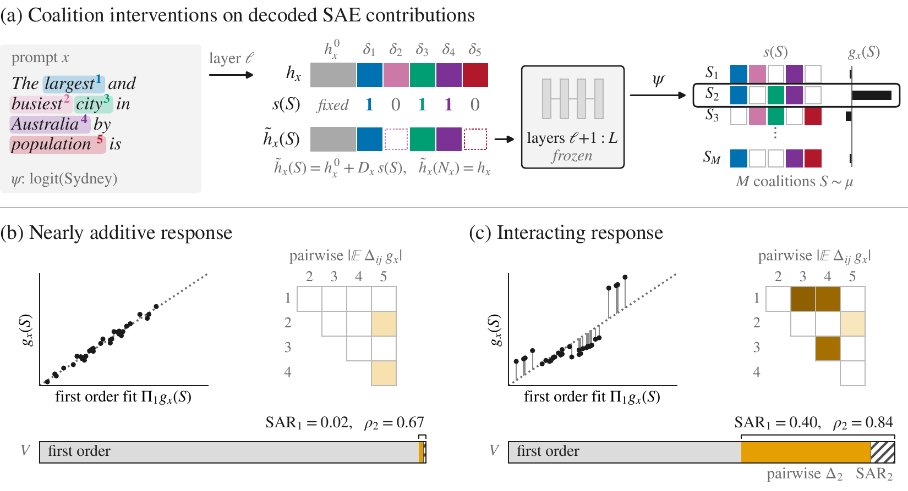
</p>

**Figure 1.** Behavioral compositionality in SAE coordinates. (a) Selected decoded contributions are retained or
removed while all other activation content is fixed, and the patched activation is propagated through the frozen upper
layers to obtain $`g_x(S)`$. (b, c) Nearly additive and interacting responses, showing the first order fit, pairwise
interactions, and variance decomposition. $`\mathrm{SAR}_1`$ is the residual beyond individual features and
$`\rho_2=\Delta_2/\mathrm{SAR}_1`$ its pairwise share.

图注为论文原文。

---

## 🎞️ 5 分钟讲解

<p align="center">
  <a href="https://opensae.github.io/SAE-Behavioral-Compositionality/">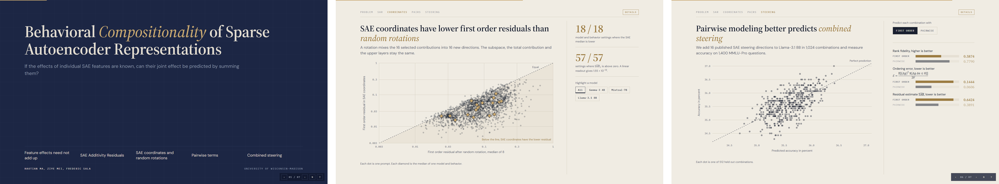</a>
</p>

💻 点击预览图即可在浏览器中打开讲解，地址是 <https://opensae.github.io/SAE-Behavioral-Compositionality/>。

---

## ✨ 亮点

- 🧮 **精确的交互分解。** 特征被独立随机保留时，$`\mathrm{SAR}_r`$ 恰好等于 $`r`$ 阶以上交互的归一化能量，并且给最优 $`r`$ 阶近似的组合排序错误设了上界。
- 📏 **经过校准。** 仿射读出的 $`\widehat{\mathrm{SAR}}_1`$ 停在数值零，最大为 $`1.55\times10^{-13}`$。真实行为在全部 57 个模型、层和行为组合中 $`\widehat{\mathrm{SAR}}_1`$ 都大于零。
- 🧭 **坐标有影响。** 在全部 18 个模型与行为设置中，学到的 SAE 坐标的一阶残差都低于同一子空间、总和不变的随机旋转。
- 🤝 **特征对补回缺失的结构。** 成对项把留出子集上的平均排序保真度从 0.9782 提高到 0.9959，并在全部 18 个设置中胜过参数量相同、改用随机三阶项的模型。
- 🎛️ **Steering 也适用。** 对 Llama-3.1 8B 上 16 个已发表的 SAE steering 特征，成对建模把 MMLU-Pro 上的排序保真度从 0.5874 提高到 0.7790。
- 🔬 **不同于重建质量。** 在 6 个可比的 SAE 上，$`\widehat{\mathrm{SAR}}_1`$ 与符号错误和选择遗憾相关，重建误差则不相关。
- ⚡ **代码很小。** 估计器是一个只依赖 NumPy 的文件 [`sar.py`](sar.py)。GPT-2 demo 在 GPU 上约一分钟跑完。

---

## 📐 SAR 衡量什么

🎯 **干预方式。** 对 prompt $`x`$，记 $`h_x`$ 为某一层某个 token 的激活。SAE 用特征激活 $`z_i(x)`$ 和解码方向 $`d_i`$ 来表示它。记 $`N_x`$ 为激活最强的 $`K`$ 个特征，它们的解码贡献为 $`\delta_i(x)=z_i(x)d_i`$。保留子集 $`S\subseteq N_x`$ 得到

$$\tilde h_x(S)=h_x^0+\sum_{i\in S}\delta_i(x),$$

其中 $`h_x^0`$ 包含激活的所有其他内容，也包括重建残差。修改后的激活经过冻结的上层，再由一个标量行为 $`\psi`$ 读出，例如 logit 差，得到 $`g_x(S)`$。

🧩 **SAE 可加性残差。** 子集的抽法是每个特征独立地以 $`1/2`$ 的概率保留。记 $`\Pi_r g_x`$ 为只用不超过 $`r`$ 个特征的项对 $`g_x`$ 的最优近似，$`V`$ 为 $`g_x`$ 的方差。定义

$$\mathrm{SAR}_r=\frac{\lVert g_x-\Pi_r g_x\rVert_\mu^2}{V},\qquad \Delta_2=\mathrm{SAR}_1-\mathrm{SAR}_2,\qquad \rho_2=\frac{\Delta_2}{\mathrm{SAR}_1}.$$

$`\mathrm{SAR}_1`$ 是单个特征效应解释不了的行为方差占比，$`\rho_2`$ 是其中能被特征对补回的部分。

🎲 **估计方法。** 取 $`K=16`$，每个 prompt 抽 384 个子集，用其中 256 个做最小二乘拟合，在另外 128 个上评估。记 $`\widehat L_r`$ 为留出子集上的均方误差，$`\widehat V`$ 为留出子集上 $`g_x`$ 的方差，报告的估计为 $`\widehat{\mathrm{SAR}}_r=\widehat L_r/(\widehat V+\epsilon)`$。

✅ **解释保真度。** 在留出子集 $`\mathcal U`$ 上，我们还衡量拟合出的模型 $`\widehat a_r`$ 能否正确排序和挑选子集。

| 指标 | 定义 | 含义 |
|---|---|---|
| 排序保真度 | $`F^{(r)}_{\mathrm{rank}}=\mathrm{Spearman}_{S\in\mathcal U}\big(\widehat a_r(S),g_x(S)\big)`$ | 等于 1 表示模型把所有留出子集都排对了 |
| 排序错误 | $`\mathcal E(a)=\mathbb E\big[(\Delta g)^2\,\mathbf 1\{\Delta g\,\Delta a\le 0\}\big]/(2V)`$ | 排反的子集对，按两者的行为差加权 |
| 符号错误 | 满足 $`\mathrm{sign}\,e(S)\ne\mathrm{sign}\,\widehat e_r(S)`$ 的 $`S\in\mathcal U`$ 所占比例，其中 $`e(S)=g_x(S)-g_x(N_x)`$，$`\widehat e_r(S)=\widehat a_r(S)-\widehat a_r(N_x)`$ | 模型把变化的方向判断反了 |
| 选择遗憾 | $`\big(g_x(S^\star)-g_x(\widehat S_r)\big)/\big(\max_{\mathcal U}g_x-\min_{\mathcal U}g_x\big)`$ | 按模型挑出的子集比真正最好的子集差多少 |

这里 $`\Delta g=g_x(S)-g_x(T)`$，$`\Delta a=a(S)-a(T)`$，$`S`$ 和 $`T`$ 是两个独立抽取的子集。$`S^\star`$ 是留出子集中真正最好的子集，$`\widehat S_r`$ 是模型排在第一的子集。论文证明了 $`\mathcal E(\Pi_r g_x)\le\mathrm{SAR}_r`$。

🔢 **数值约定。** `sar.py` 沿用论文代码的数值约定，算出的数字与论文一致。估计里用 $`\epsilon=10^{-8}`$，对 logit 量级的行为可以忽略。但当 $`\widehat V`$ 很小时，它会让 $`\widehat{\mathrm{SAR}}_r`$ 随行为的尺度变化，所以 $`\epsilon`$ 超过 $`\widehat V`$ 的 1% 时 `sar` 会给出警告。在论文实验的 4,900 个 prompt 上，$`\epsilon`$ 对估计的影响最多 1.4%。$`\widehat{\mathrm{SAR}}_1\le10^{-4}`$ 时不定义 $`\widehat\rho_2`$。符号按精确值比较，只有一侧的变化恰好为零时也算符号错误。

🔄 **旋转坐标。** 为了检验组合性是否取决于 SAE 的坐标，我们把贡献矩阵 $`D_x=[\delta_1,\dots,\delta_K]`$ 换成 $`D_xQ`$，其中 $`Q`$ 是随机正交矩阵并满足 $`Q\mathbf 1=\mathbf 1`$。这样选中的子空间、总贡献和上层都不变。

---

## 🔎 方法对比

🔗 **解释特征组合。** 解释几个特征一起起什么作用，常见做法是把每个特征单独的作用加起来，这就是一阶模型。我们把它与成对模型比较，再加一个对照，它加入同样多个随机的三特征项。所有模型都在同样的 256 个子集上拟合，在同样的 128 个留出子集上评估，数字是 18 个模型与行为设置的平均。

| 模型 | $`K=16`$ 时的项数 | 留出排序保真度 | 排序错误 |
|---|:---:|:---:|:---:|
| 一阶，每个特征一个效应 | 17 | 0.9782 | 基准 |
| 🏆 **成对，每个特征和每对特征各一个效应** | 137 | ✅ **0.9959** | ✅ 18 个设置中都更低 |
| 随机三阶项对照 | 137 | ❌ 18 个设置中都低于成对 | ❌ 18 个设置中都高于成对 |

⚖️ **评估 SAE。** SAE 的质量通常用重建误差来报告。我们在 Gemma-3 1B 同一位置的 6 个 SAE 上，比较重建误差和 $`\widehat{\mathrm{SAR}}_1`$ 与一阶解释的两种失误有多大关系。数字是三种行为上按 prompt 计算的 Spearman 相关。

| 指标 | 衡量什么 | 与符号错误 | 与选择遗憾 |
|---|---|:---:|:---:|
| 重建误差 $`\mathrm{FVU}_x`$ | SAE 重建激活的好坏 | ❌ −0.114 到 −0.013 | ❌ 0.005 到 0.028 |
| 🏆 $`\widehat{\mathrm{SAR}}_1`$ | 单个特征效应解释不了的行为 | ✅ **0.269 到 0.430** | ✅ **0.199 到 0.235** |

---

## ⚙️ 安装

```bash
git clone https://github.com/UniqueMax2005/sar-compositionality.git
cd sar-compositionality
python -m venv .venv && source .venv/bin/activate    # Windows 上用 .venv\Scripts\activate
pip install -r requirements.txt
```

`sar.py` 只需要 NumPy。demo 另外需要 PyTorch、TransformerLens、SAE Lens 和 Matplotlib。[`requirements-lock.txt`](requirements-lock.txt) 固定了下面 demo 输出所用的确切版本，运行环境是 Python 3.12。测试检查论文依赖的数学性质：仿射行为的残差为零，成对博弈能被成对模型完全恢复，旋转保持贡献的子空间和总和不变。

```bash
python -m pytest
```

---

## 🚀 快速上手

```python
import numpy as np
from sar import coalitions, sar

masks, fit, held = coalitions(K=6)                                # 384 个子集，256 个拟合，128 个留出
s = masks.astype(float)                                           # s[m, i] = 1 表示子集 m 保留特征 i
noise = 0.02 * np.random.default_rng(0).standard_normal(len(s))   # 少量测量噪声
g = s @ [1.0, 0.5, 1.0, -0.3, 0.2, 0.1] - 1.0 * s[:, 0] * s[:, 2] + noise  # 特征 0 和 2 是冗余的

r = sar(g, masks, fit, held)
print(f"SAR_1 {r['sar1']:.3f}  SAR_2 {r['sar2']:.3f}  rho_2 {r['rho2']:.2f}")
print(f"rank fidelity {r['rank1']:.3f} -> {r['rank2']:.3f}")
# SAR_1 0.271  SAR_2 0.002  rho_2 0.99
# rank fidelity 0.850 -> 0.991
```

💡 特征 0 和 2 单独各加 1，同时保留也只加 1。一阶模型留下 27% 的留出方差解释不了，加入特征对后除测量噪声外全部补回。

🔌 **接入自己的模型。** 在真实模型上，`g` 来自上面的干预。取 SAE 位置的激活 `h` 和 $`K`$ 个解码贡献 `delta`，形状为 `(K, d)`。每个子集去掉它没有保留的贡献，再由你的模型把每个修改后的激活变成一个数。

```python
h_tilde = h - (~masks).astype(float) @ delta     # 每个子集一个修改后的激活
g = np.array([behavior(x) for x in h_tilde])     # 跑完上层，读出一个标量
r = sar(g, masks, fit, held)
```

在 [`demo.py`](demo.py) 里这两步就是 `top_contributions` 和 `behavior`，换模型、换 SAE 或换行为时只需要替换这两个函数。旋转坐标用 `rotation(K)` 得到随机的 $`Q`$，贡献换成 `Q.T @ delta`。

👉 在 GPT-2 Small 上运行

```bash
python demo.py
```

---

## 📊 主要结果

#### 🧠 Figure 2. 行为组合性随行为和表示而变化

每种组合 1,000 个 prompt 的 $`\widehat{\mathrm{SAR}}_1`$ 中位数。

| | 简单复制 | 主谓一致 | 性别代词 | CounterFact | IOI | 大于比较 |
|---|:---:|:---:|:---:|:---:|:---:|:---:|
| Gemma-3 4B，第 22 层 | 0.03668 | 0.03732 | 0.03532 | 0.05275 | 0.04174 | 0.02121 |
| Mistral-7B，第 24 层 | 0.02029 | 0.02435 | 0.04939 | 0.05535 | 0.01510 | 0.04159 |
| Llama-3.1 8B，第 21 层 | 0.04486 | 0.03070 | 0.08244 | 0.07707 | 0.04245 | 0.05625 |

$`\widehat{\mathrm{SAR}}_1`$ 在全部 57 个模型、层和行为组合中都大于零，仿射对照则停在数值零。它的大小同时取决于行为和模型。

#### 🧭 Figure 3. 组合性取决于坐标的选择

SAE 坐标与随机旋转的 $`\widehat{\mathrm{SAR}}_1`$ 中位数，每格 100 个 prompt，每个 prompt 8 个旋转。

| SAE / 旋转 | 简单复制 | 主谓一致 | 性别代词 | CounterFact | IOI | 大于比较 |
|---|:---:|:---:|:---:|:---:|:---:|:---:|
| Gemma-3 4B | **0.041** / 0.083 | **0.033** / 0.076 | **0.039** / 0.081 | **0.056** / 0.094 | **0.021** / 0.024 | **0.022** / 0.032 |
| Mistral-7B | **0.023** / 0.058 | **0.022** / 0.120 | **0.024** / 0.141 | **0.055** / 0.133 | **0.016** / 0.038 | **0.065** / 0.066 |
| Llama-3.1 8B | **0.059** / 0.166 | **0.019** / 0.070 | **0.109** / 0.149 | **0.080** / 0.138 | **0.049** / 0.079 | **0.063** / 0.178 |

每一对比较中，选中的子空间、总贡献和上层都相同，只换了坐标。18 个设置中 SAE 坐标的残差都更低。

#### 📉 Figure 4. 估计的 SAR 与一阶解释的保真度相关

从 $`\widehat{\mathrm{SAR}}_1`$ 最低的十分位到最高的十分位，一阶排序保真度在 Gemma-3 4B 上从 0.9857 降到 0.9539，在 Mistral-7B 上从 0.9939 降到 0.9413，在 Llama-3.1 8B 上从 0.9790 降到 0.9289。选择遗憾在 Gemma 和 Llama 上约翻一倍，在 Mistral 上约增加到五倍。

#### 🤝 Figure 5. 特征对补回缺失的组合结构

| 18 个设置的平均 | 一阶 | 成对 |
|---|:---:|:---:|
| 排序保真度 | 0.9782 | **0.9959** |
| 选择遗憾 | 0.0272 | **0.0051** |

成对模型在全部 18 个设置中也降低了排序错误和符号错误，这些改进在全部 20 次重新划分子集后都成立。

#### 🪜 Figures 6 and 7. 估计的组合性随深度变化

简单复制在最早和最晚采样层上的结果。

| | GPT-2 Small | Pythia-70M | Gemma-3 270M | Gemma-3 1B | Gemma-3 4B | Mistral-7B | Llama-3.1 8B |
|---|:---:|:---:|:---:|:---:|:---:|:---:|:---:|
| $`\widehat{\mathrm{SAR}}_1`$ | 0.298 → 0.013 | 0.137 → 0.0007 | 0.174 → 0.007 | 0.154 → 0.015 | 0.112 → 0.012 | 0.177 → 0.020 | 0.200 → 0.256 |
| $`\widehat\rho_2`$ | 0.34 → 0.95 | 0.59 → 1.00 | 0.70 → 0.99 | 0.70 → 0.98 | 0.58 → 0.71 | 0.53 → 0.79 | 0.54 → 0.78 |

在 Figure 6 的 9 组从浅到深的比较中，$`\widehat{\mathrm{SAR}}_1`$ 有 8 组下降，$`\widehat\rho_2`$ 9 组全部上升。在全部 33 个模型、行为和层的比较中，SAE 坐标的 $`\widehat{\mathrm{SAR}}_1`$ 都低于旋转。

#### 🎛️ Table 1. 成对建模更好地预测组合 steering 的结果

Llama-3.1 8B 上 16 个已发表的 CorrSteer 特征，1,024 种 steering 组合，1,400 道 MMLU-Pro 题。

| 近似 | 残差估计 | 排序保真度 | 排序错误 |
|---|:---:|:---:|:---:|
| 一阶 | 0.6424 | 0.5874 | 0.1444 |
| 成对 | **0.3891** | **0.7790** | **0.0606** |

#### 🔬 Table 2 and Figure 8. 重建质量与 SAR 在可比的 SAE 上表现不同

Gemma-3 1B 第 17 层 6 个 SAE 合并，按 prompt 计算的 Spearman 相关，每种行为 1,800 个 prompt。

| 行为 | $`\mathrm{FVU}_x`$ 与符号错误 | $`\widehat{\mathrm{SAR}}_1`$ 与符号错误 | $`\mathrm{FVU}_x`$ 与选择遗憾 | $`\widehat{\mathrm{SAR}}_1`$ 与选择遗憾 |
|---|:---:|:---:|:---:|:---:|
| 简单复制 | −0.080 | **0.269** | 0.011 | **0.220** |
| 主谓一致 | −0.114 | **0.430** | 0.005 | **0.235** |
| IOI | −0.013 | **0.396** | 0.028 | **0.199** |

---

## 🧪 Demo

`demo.py` 用 GPT-2 Small 和它的公开 SAE，在我们写的 24 个复制型 prompt 上运行，例如 "Alice Emma Alice"。模型应当接着输出 " Emma"，行为是 " Emma" 的 logit 减去另一个名字的 logit。对每个 prompt，demo 保留激活最强的 16 个特征，抽 384 个子集，并把 SAE 坐标与 8 个随机旋转比较。`python demo.py` 跑第 4 和第 10 层，GPU 上约一分钟，CPU 上约五分钟。加上 `--layers 4 6 8 10` 会跑论文用到的全部四层。

```bash
python demo.py --layers 4 6 8 10
```

```text
GPT-2 Small, 24 copying prompts, K = 16, 384 coalitions (256 fit, 128 held out)

Layer  SAR_1 SAE  SAR_1 rotated  SAE lower   rho_2  affine SAR_1
    4     0.3232         0.5652     24 / 24   0.383       2.3e-27
    6     0.3236         0.3647     19 / 24   0.762       1.1e-26
    8     0.0322         0.0685     21 / 24   0.918       1.0e-26
   10     0.0148         0.0481     24 / 24   0.945       6.5e-26

         Rank fidelity     Ordering error       Sign error      Selection regret
Layer     first pairwise     first pairwise     first pairwise     first pairwise
    4    0.7955   0.8519    0.0391   0.0187    0.2614   0.2002    0.1520   0.0632
    6    0.8255   0.9150    0.0179   0.0046    0.2887   0.1895    0.1045   0.0424
    8    0.9821   0.9959    0.0013   0.0001    0.0547   0.0309    0.0224   0.0034
   10    0.9847   0.9967    0.0018   0.0002    0.0472   0.0254    0.0139   0.0017
```

第一张表依次是 SAE 坐标和旋转坐标的 $`\widehat{\mathrm{SAR}}_1`$ 中位数、SAE 更低的 prompt 数、$`\widehat\rho_2`$ 中位数，以及仿射读出的最大 $`\widehat{\mathrm{SAR}}_1`$。第二张表是上面定义的解释保真度指标在各 prompt 上的平均。

<p align="center">
  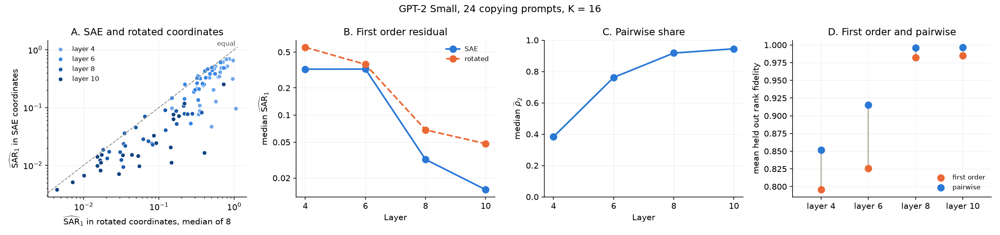
</p>

✅ demo 呈现与论文相同的规律。SAE 坐标的残差低于旋转，$`\widehat{\mathrm{SAR}}_1`$ 随深度下降而 $`\widehat\rho_2`$ 上升，每一层的成对模型对留出子集的排序都更准。论文用 1,000 个 prompt 得到的结果是，从第 4 层到第 10 层 $`\widehat{\mathrm{SAR}}_1`$ 从 0.2978 降到 0.01309，$`\widehat\rho_2`$ 从 0.3437 升到 0.9491。

---

## 🗺️ 图表索引

图注取自论文原文。

| 图 | 图注 | Demo 中 |
|---|---|:---:|
| [Figure&nbsp;1](assets/figures/fig1.png) | Behavioral compositionality in SAE coordinates. | ✅ |
| [Figure&nbsp;2](assets/figures/fig2.png) | Prompt median $`\widehat{\mathrm{SAR}}_1`$ for six behaviors in Gemma-3 4B layer 22, Mistral-7B layer 24, and Llama-3.1 8B layer 21. Error bars show 95% prompt bootstrap intervals. | |
| [Figure&nbsp;3](assets/figures/fig3.png) | Paired first order SAR for learned SAE coordinates and sum preserving random rotations of the same selected activation subspace. | ✅ A 图 |
| [Figure&nbsp;4](assets/figures/fig4.png) | First order explanation fidelity across $`\widehat{\mathrm{SAR}}_1`$ deciles within each model. | |
| [Figure&nbsp;5](assets/figures/fig5.png) | Held out coalition ordering for first order and pairwise approximations. | ✅ D 图 |
| [Figure&nbsp;6](assets/figures/fig6.png) | Depth profiles for simple copying, CounterFact, and IOI. | ✅ B 和 C 图 |
| [Figure&nbsp;7](assets/figures/fig7.png) | Simple copying at the earliest and latest sampled layers across seven model and SAE pipelines. | ✅ GPT-2 一行 |
| [Figure&nbsp;8](assets/figures/fig8.png) | Median prompt level $`\mathrm{FVU}_x`$ and median $`\widehat{\mathrm{SAR}}_1`$ for six SAEs at Gemma-3 1B layer 17. | |
| [Figure&nbsp;9](assets/figures/fig9.png) | Behavior scores for four examples under ablations of individual features and feature pairs, together with first order and pairwise predictions when available. | |

<details>
<summary>展开所有图</summary>

| | |
|---|---|
| 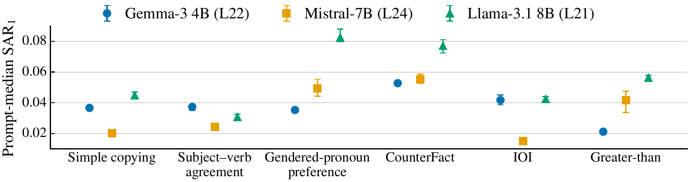<br>Figure 2 | 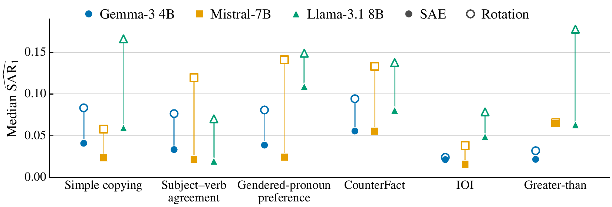<br>Figure 3 |
| 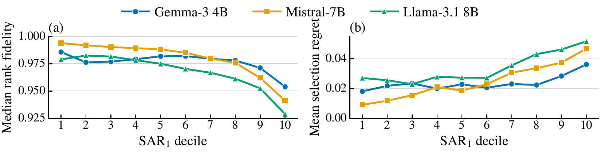<br>Figure 4 | 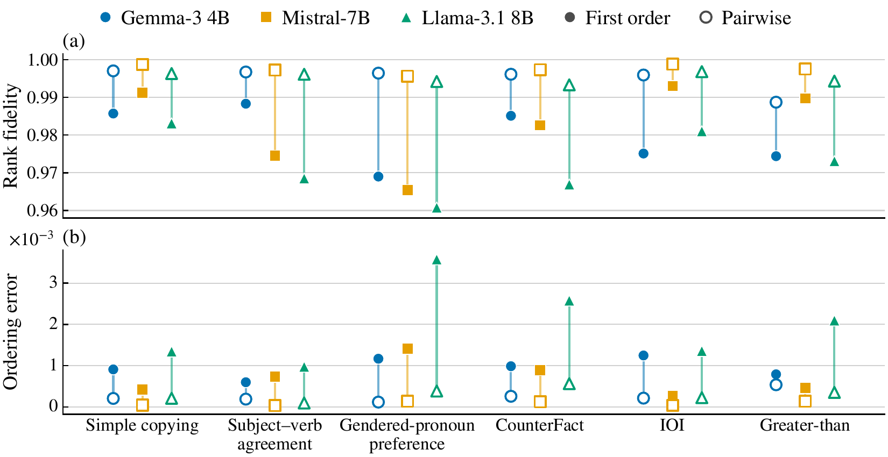<br>Figure 5 |
| 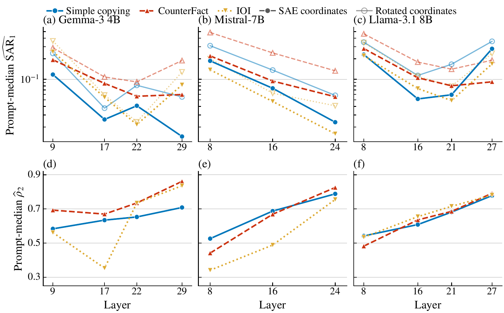<br>Figure 6 | 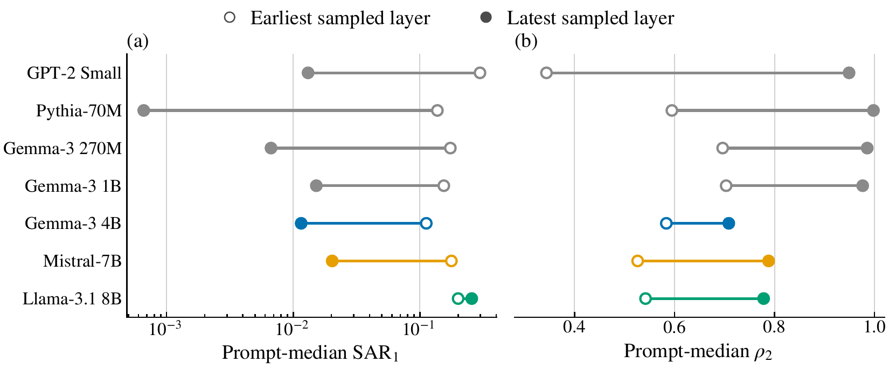<br>Figure 7 |
| 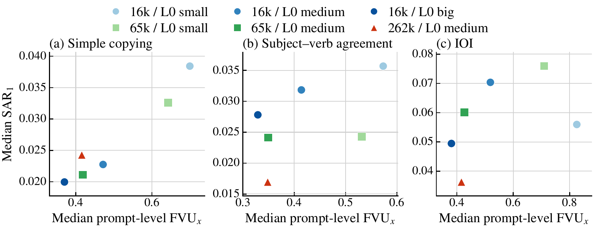<br>Figure 8 | 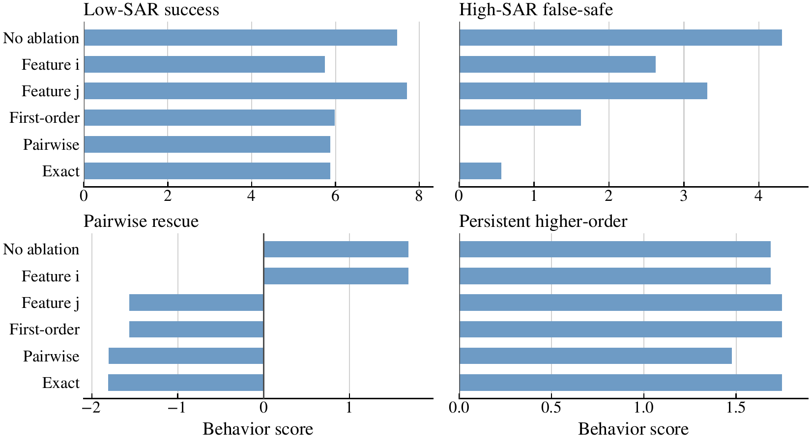<br>Figure 9 |

</details>

---

## 🙏 致谢

本项目基于 [SAE Lens](https://github.com/decoderesearch/SAELens)、[TransformerLens](https://github.com/TransformerLensOrg/TransformerLens) 和 [Neuronpedia](https://www.neuronpedia.org)。使用了 [GPT-2 Small](https://huggingface.co/jbloom/GPT2-Small-SAEs-Reformatted)、[Pythia-70M](https://huggingface.co/ctigges/pythia-70m-deduped__res-sm_processed)、[Gemma Scope 2](https://huggingface.co/google/gemma-scope-2-4b-pt)、[Mistral-7B](https://huggingface.co/JoshEngels/Mistral-7B-Residual-Stream-SAEs) 和 [Llama Scope](https://huggingface.co/OpenMOSS-Team/Llama3_1-8B-Base-LXR-8x) 的开源 SAE，[CounterFact](https://rome.baulab.info)、[IOI](https://arxiv.org/abs/2211.00593) 和 [MMLU-Pro](https://huggingface.co/datasets/TIGER-Lab/MMLU-Pro) 数据，以及 [CorrSteer](https://arxiv.org/abs/2508.12535) 的 steering 特征。
